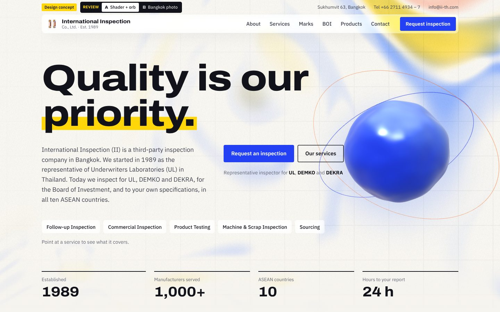
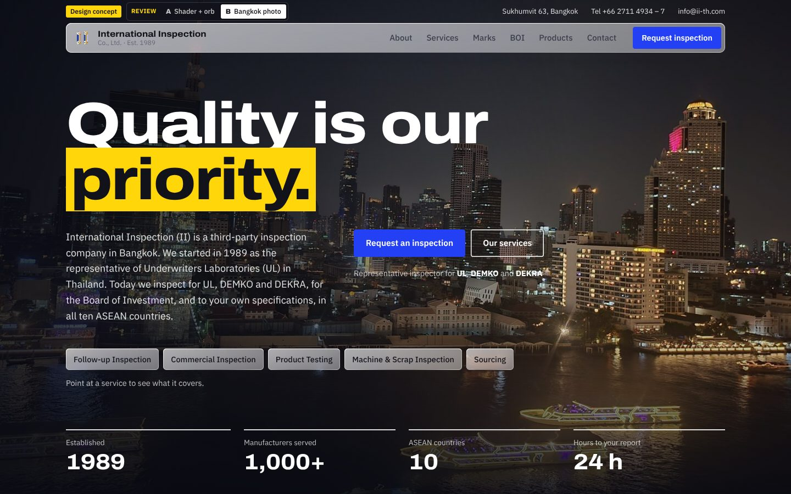
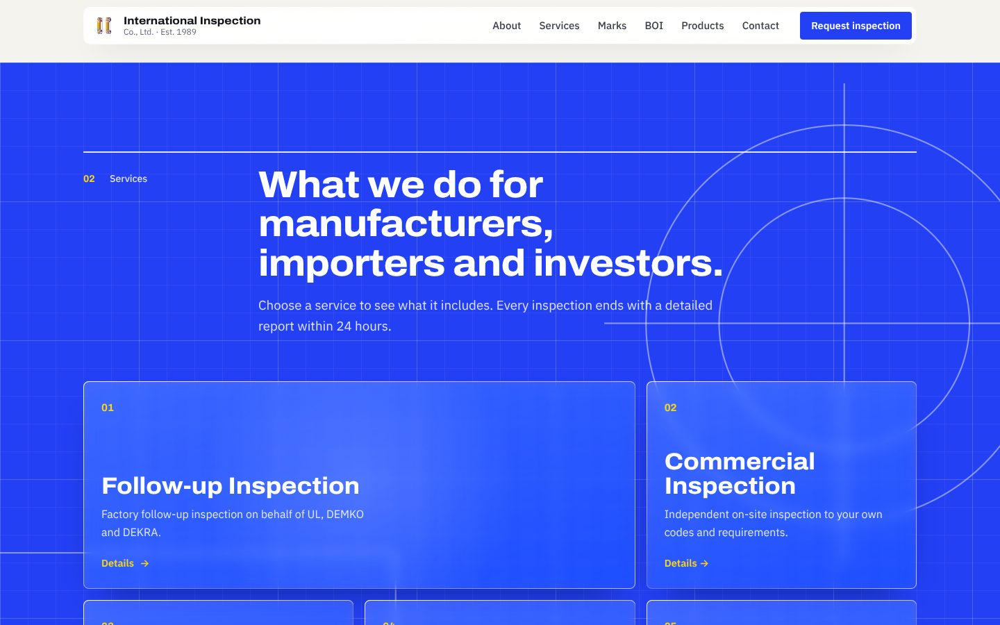
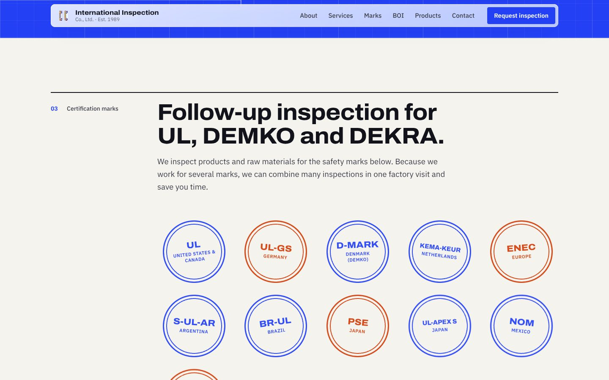
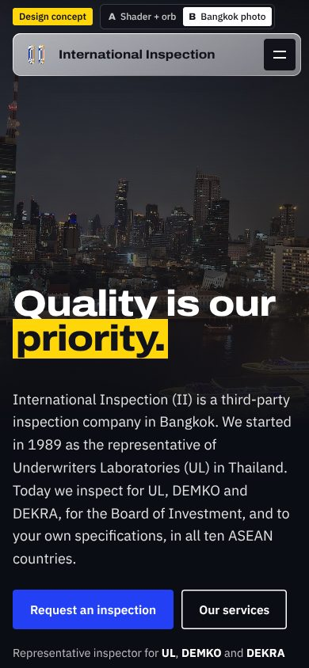
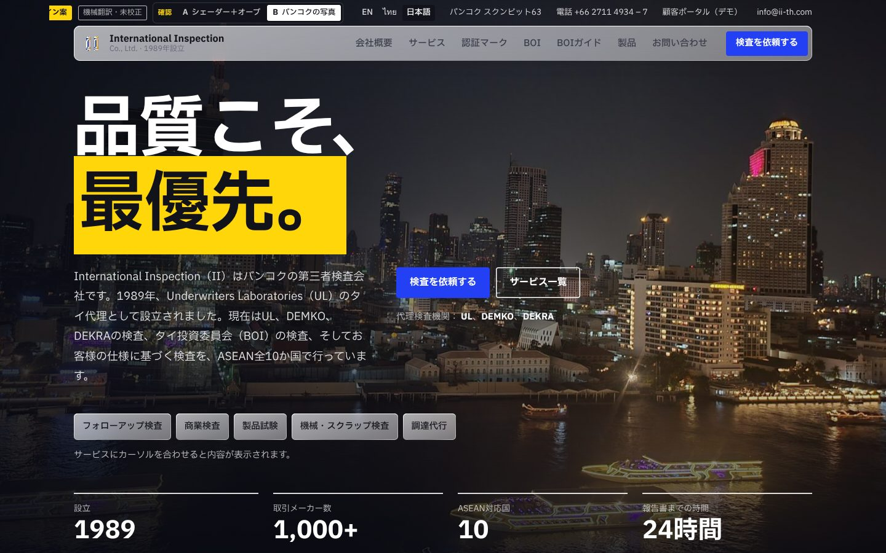
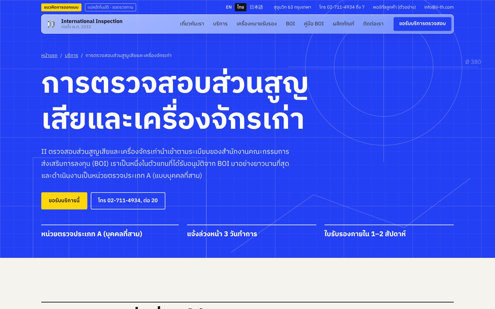
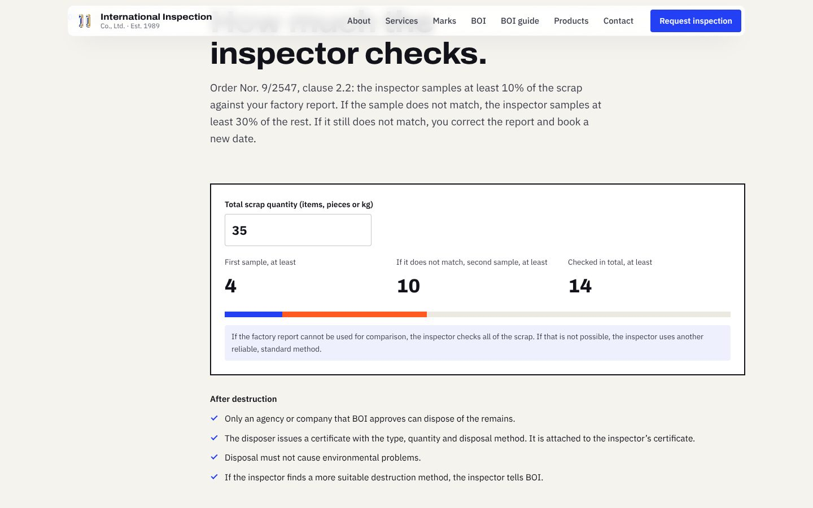
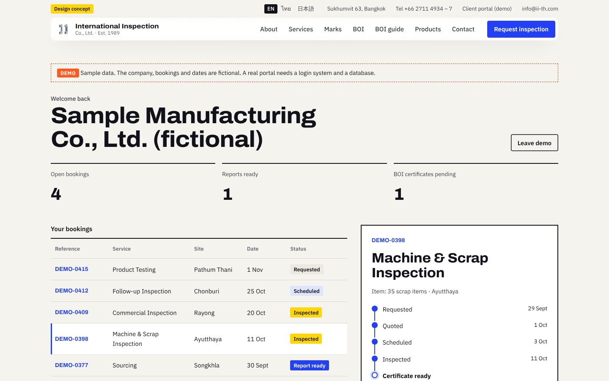

# International Inspection (II) — website concept

A concept redesign of [ii-th.com](https://www.ii-th.com/) for International Inspection Co., Ltd.
All content comes from the crawl in `../reference/ii-th`.

> This is a proposal. It is not the official website. A "Design concept" tag shows in the top bar, and the footer says so too.

## Screenshots

| | |
| --- | --- |
|  |  |
|  |  |
|  |  |
|  |  |
|  |  |

## Clients

The section directly after the hero shows II's 16 client logos in one straight grid: Sony, DuPont, Walmart, Kimberly-Clark, Dell, Philips, LG, IBM, General Electric, Sharp, Whirlpool, 3M, HP, Honeywell, Dow and Panasonic. These are the logos from the "Our Clients" slideshow on II's current home page, in the same order. The other clients that II names in its text follow as one line.

The saved HTML of the old site has only the first three slides. The full set comes from a live snapshot (`reference/ii-th/live/`: screenshots, and every image the pages load).

## Two versions for review

The hero comes in two versions. Use the **Review** switch in the top bar to change between them. The rest of the page is the same.

| Version | Hero | Link |
| --- | --- | --- |
| A | Light shader gradient with the "thinking orb" | `?v=shader` |
| B | Bangkok night photo of the Chao Phraya. The river shimmers and ripples under the pointer; the city stays still. | `?v=photo` |

The choice is kept in the URL, so you can send a link to one version. The browser also remembers the last choice.

**Photo:** "[Chao Phraya et Bang Rak vus de l'Iconsiam](https://commons.wikimedia.org/wiki/File:Chao_Phraya_et_Bang_Rak_vus_de_l%27Iconsiam.jpg)", Wikimedia Commons, **CC0** (public domain, no attribution needed; credited in the footer anyway). Original 4032 × 3024. It shows the same river-and-skyline scene as the banner on II's current home page (State Tower, King Power MahaNakhon, Mandarin Oriental, Old Customs House). The site serves 960, 1600, 2560 and 3840 px versions (`public/img/`) and picks one for the screen size. II's own banner (1600 × 600) is kept for reference in `reference/ii-th/images/home-banner.jpg`.

## Run it

```bash
cd site
npm install
npm run dev        # local dev server
npm run build      # type-check, build to site/dist, then write one HTML file per page
npm run preview    # serve the build
```

The build is static. You can host `dist/` on any static host, for example GitHub Pages, Netlify, Cloudflare Pages or Vercel.

Build settings (environment variables):

| Variable | Default | Use |
| --- | --- | --- |
| `BASE` | `/` | Site path. The Pages workflow sets it to the repository sub-path (`/websitebuilder/`). |
| `SITE_URL` | `https://www.ii-th.com` | Used for canonical links, social previews and the sitemap. |
| `ALLOW_INDEXING` | off | Set to `1` at launch to remove the concept's `noindex` tag. |

## Pages and enquiries (Phase 1)

| Address | Page |
| --- | --- |
| `/` | Home, with the two hero versions |
| `/services/follow-up-inspection/` | Follow-up inspection (UL, DEMKO, DEKRA) |
| `/services/commercial-inspection/` | Commercial inspection |
| `/services/product-testing/` | Product testing |
| `/services/boi-machine-scrap-inspection/` | BOI machine and scrap inspection |
| `/services/sourcing/` | Sourcing |
| `/guides/boi-scrap-write-off/` | BOI scrap write-off guide (Phase 3) |
| `/portal/` | Client portal **demo** (Phase 3) |
| `/privacy/` | Privacy notice (**draft**) |

Each page is a real HTML file with its own title, description, canonical link, social preview and structured data (schema.org `ProfessionalService` on the home page, `Service` on each service page). Pages, titles and redirects are defined in `src/pages.json`; `scripts/build-pages.mjs` writes them after `vite build`.

Each service page has: key facts, what we provide, a service-specific section (marks, products, or the BOI fold and documents), **how booking works**, an **FAQ**, and the request form preset to that service. FAQ answers use only facts from II's pages and PDFs (`src/locales/en.ts`, `faqs`).

**Request form**
- Fields change with the service (for example inspection type for commercial inspection, factory location and planned date for BOI).
- BOI dates start at today + 3 working days, from clause 3.1 of II's BOI scrap conditions. Thai public holidays are not counted; the form says so.
- A consent box links to the privacy notice and must be ticked.
- Sending opens the visitor's email app. The full request is also shown with a **Copy request** button, so webmail users can still send it.
- LINE and WhatsApp buttons show "ID needed" until II's IDs are added to `chat` in `src/content.ts`.

**Old addresses:** every page of the old Wix site (English, Thai and Chinese) redirects to its new page. On a static host a small redirect page per old address does this; `dist/_redirects` gives the same list as real 301 redirects for Netlify or Cloudflare Pages. This keeps existing Google rankings when the domain moves.

**Analytics:** `src/analytics.ts` records `request_submit`, `request_copy`, `phone_click`, `email_click`, `line_click`, `whatsapp_click`, `faq_open`, `language_switch`, `guide_print`, `guide_cta`, `portal_open`, `portal_download` and `portal_book_again`. Nothing is sent until an analytics tool (for example Plausible or Google Tag Manager) is added and the privacy notice covers it.

## Languages (Phase 2)

| Language | Address | Text |
| --- | --- | --- |
| English | `/` | `src/locales/en.ts` (source) |
| Thai | `/th/` | `src/locales/th.ts` |
| Japanese | `/ja/` | `src/locales/ja.ts` |

Every page exists in all three languages (9 pages × 3 = 27 HTML files). The top bar has a language switch. It keeps the page, the hero version and the section.

- **Machine translation.** The Thai and Japanese text is machine translated and not yet reviewed. Each Thai and Japanese page says so in the top bar (desktop) and the footer. Set `machineTranslated: false` in a locale file when a native speaker has approved it.
- **Thai wording.** Where II's old Thai pages and PDFs have a term, the Thai version uses it: service names, the BOI terms, the Thai address, the phone format and the PDF titles.
- **One set of keys.** `th.ts` and `ja.ts` have the type `Locale` from `en.ts`. The build fails if a key is missing.
- **Fonts.** Thai pages load IBM Plex Sans Thai; Japanese pages load IBM Plex Sans JP. Other pages do not download them.
- **Request emails stay in English.** Labels, the service name and the option values in the email are English in every language, so II receives one format.
- **Search engines.** Each page has `hreflang` links to its other languages, `og:locale`, and a translated title and description (`src/pages.json`). Old Thai Wix addresses redirect to the Thai pages.

## Phase 3: what a full site could do

Two working demonstrations, in all three languages.

**BOI scrap write-off guide** (`/guides/boi-scrap-write-off/`). A plain-language guide built only from the BOI documents II already publishes: Announcements Por. 4/2543 and Por. 5/2543, Order Nor. 9/2547, and II's BOI scrap conditions.
- **Which rule applies?** A switch between Section 36(1) and Section 30 shows when scrap is written off without duty and when duty is due.
- **Sampling calculator.** Enter the scrap quantity; it shows the minimum first sample (10%), the second sample if the report does not match (30% of the rest), and the total. From Order Nor. 9/2547, clause 2.2.
- **Checklist** for inspection day, with progress and a print button.
- Links to the four source PDFs, and a button to book a BOI inspection.
- It is in the nav, the footer and the BOI section. A guide like this can rank in search for BOI questions and bring in enquiries.

**Client portal demo** (`/portal/`). Shows what clients could see after they book.
- No login: one button opens the demo. There are no password or email fields.
- A fictional company with five sample bookings, one per service. Dates move with today's date.
- Status timeline: Requested → Quoted → Scheduled → Inspected → Report ready (Certificate ready for BOI).
- BOI certificate window: day count since the inspection, against the 1–2 week issue time.
- "Download report" says plainly that the demo has no reports. "Book again" opens the request form for that service.
- A "Demo" banner says the data is fictional. The page is `noindex` even at launch, and it is not in the sitemap.
- A real portal needs a login system, a database and II's booking data. That is a separate project.

### Launch checklist
1. Confirm the content audit below and the draft privacy notice with II.
2. Have a native speaker review `th.ts` and `ja.ts`, then set `machineTranslated: false`.
3. Add II's LINE and WhatsApp IDs.
4. Add analytics, and update the privacy notice to cover it.
5. Replace the email-based form with a form service (for example Formspree) or the host's own forms.
6. Remove the review switch and the "Design concept" tag; keep the photo credit if version B is chosen.
7. Remove the portal demo, or replace it with a real portal.
8. Build with `SITE_URL=https://www.ii-th.com ALLOW_INDEXING=1`, point the domain at the new host, and submit `sitemap.xml` in Google Search Console.

## Stack

- Vite, React 19, TypeScript
- three.js and `@react-three/fiber` for the hero scene. This chunk loads after first paint.
- Self-hosted fonts (`@fontsource`): Archivo (variable width, set semi-expanded for headings) and IBM Plex Sans (body). IBM Plex Sans Thai and IBM Plex Sans JP for the Thai and Japanese pages.

## Visual language

The design avoids the usual "AI template" look (gradient text, serif italic accent words, mono uppercase labels, pill buttons, blurred colour blobs). Instead:

- **Palette:** paper `#f5f3ee`, ink `#12131a`, signal blue `#2340f5`, safety yellow `#ffd60a`, stamp orange `#ff5a1f`. No gradient text.
- **Grid:** Swiss-style. Each section has a numbered label in a left column and a full-width rule above.
- **Devices from inspection work:** a yellow highlighter stroke on the hero tagline, rubber-stamp badges for the certification marks, a blueprint grid behind the services, and report-style stat rows.
- **Copy:** plain company language, with II's own tagline "Quality is our priority."

## Design references and where they are used

| Reference | Where | How |
| --- | --- | --- |
| Custom shaders | Hero background | GLSL domain-warped simplex noise with an inspection grid and film grain (`src/effects/HeroScene.tsx`, `Field`) |
| ShaderGradient | Hero background | The same soft, liquid gradient look. It is written as a custom shader, with no extra dependency. |
| Thinking orb | Hero | A noise-displaced, candy-glass sphere with a scan ring. It rests in signal blue. Point at a service chip and the orb "thinks": it pulses, speeds up and changes to that service's colour (`Orb`, `src/state.ts`). |
| react-three-fiber | Hero | Renders the field and the orb. It pauses when the hero is off-screen. |
| liquid-logo (paper-design) | Removed | An early version used a liquid-metal "II" placeholder mark. II's real logo replaced it: the logo is a large flat block, which the effect cannot show well. |
| liquidglass.js | Nav, chips, service cards, form | Per-element edge-displacement map through an SVG `feDisplacementMap` in `backdrop-filter` (`src/effects/Glass.tsx`). The service cards refract the blueprint lines, and the form refracts the shapes behind it. Chromium desktop gets refraction. Other browsers get frosted glass. |
| Screen-fold illusion | BOI section | A nested accordion of panels that folds like paper and unfolds as you scroll (`src/effects/FoldChain.tsx`). |

## Accessibility and performance

- `prefers-reduced-motion`: the WebGL scenes render one still frame, the fold stays flat, and CSS animations stop.
- No WebGL: the hero shows a CSS gradient.
- No horizontal scroll at 390 px or 1440 px wide (checked with Playwright).

## Content sources

| Section | Source page in the crawl |
| --- | --- |
| Hero, stats, why us | `/`, `/why-us` |
| Story and timeline | `/about-ii`, Thai BOI page, ISO/IEC 17020 PDFs |
| Services | `/services`, `/follow-up-inspection-services`, `/commercial-inspection-and-testing`, `/testing-services`, `/machine-and-scrap-inspection`, `/sourcing-services` |
| Marks | `/follow-up-inspection-services`: names, regions, and the 13 mark images under "Certification Marks We Currently Represent", in the same order (`public/img/marks/`). BR-UL has no image there, so it shows as text. |
| Logo | II's original logo file from the old site (`public/img/ii-logo.png`); the nav and favicon use its blue-and-black block (`ii-mark.png`). |
| BOI four steps | Thai page การตรวจสอบส่วนสูญเสียและเครื่องจักรเก่า, and the BOI scrap conditions PDF (3 working days notice) |
| What we inspect | `/our-expertise` |
| Clients | Logos: the "Our Clients" slideshow on `/` (live snapshot). Names: `/machine-and-scrap-inspection`, `/`, Thai BOI page. |
| Documents | The 9 public PDFs. Links go to the original files on ii-th.com. |
| Contact | `/contact` |

## Content audit — please confirm with II

The live site could not be reached from the build environment, so the crawl is the only source. These items need a check:

1. **Office floor.** The contact page says 12th floor. The 2025 ISO/IEC 17020 scope PDF (No. 005/2568) says floor 13. The concept uses the 12th floor from the contact page.
2. **Years of experience.** The old site says "25 years", "30+ years" and "almost 40 years" on different pages. The concept calculates the number from 1989 (37 years in 2026).
3. **Testing services page.** Its "What we provide" and "Benefits" blocks are a copy of the sourcing page. The concept uses only the testing introduction, plus benefits taken from other pages.
4. **ISO/IEC 17020 status.** The PDFs say II *plans to implement* an ISO/IEC 17020 system as a Type A body. The concept does not claim accreditation. Add the accreditation number if II has one.
5. **Copyright year.** The old footer says © 2006. The concept uses the current year.
6. **Spelling.** The concept fixes typos from the old site, for example "Furakawa" → Furukawa, "KEMA-KUER" → KEMA-KEUR, "thier", "refigeration", "baterries".
7. **News.** The only news item is a 2014 UL press release. The concept leaves it out.

## Not in this concept (next steps)

- A Chinese version. The old site has one BOI page in Chinese; it redirects to the English BOI page.
- The real II logo. The liquid-metal "II" is a placeholder mark.
- Logos for the clients that II names only in text (Samsung, Hitachi, Canon and others). Add them to `CLIENT_LOGOS` in `src/content.ts` when II has files it may use.
- The Philips logo file on the old site carries a small watermark from a free-logo website; the concept crops it off. II should replace it with an official file.
- Photos of inspectors and factories. Only the hero photo is in this concept.
- A backend for the form. The form opens the visitor's email app, with a copy fallback.
- Phase 2 needs input from II: fee model or "from" prices, a sample report and certificate, team photos and bios, case studies, proof of approvals, the list of industrial estates served, and review of the Thai and Japanese translations.
