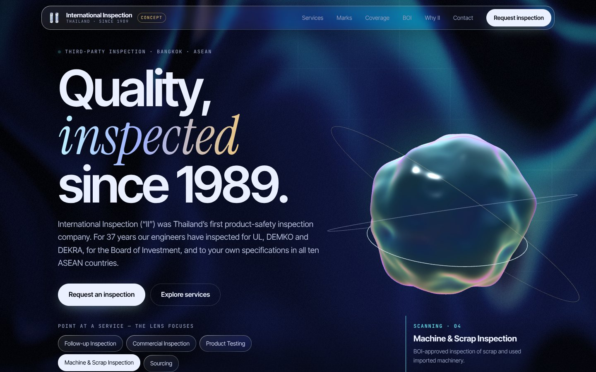
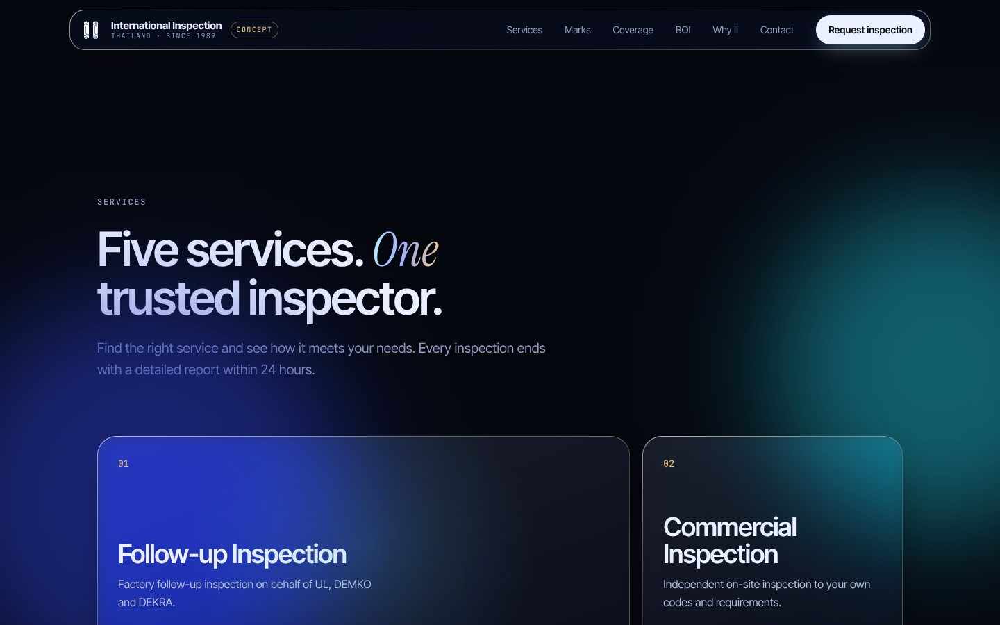
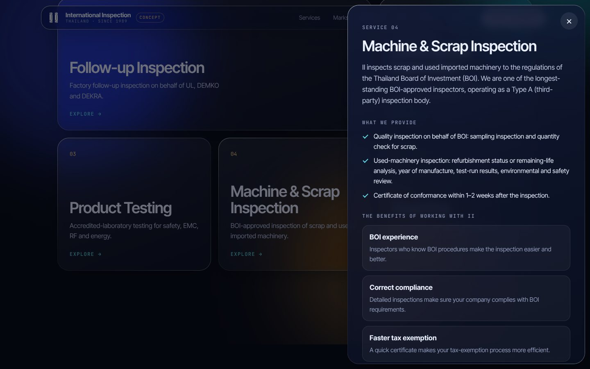
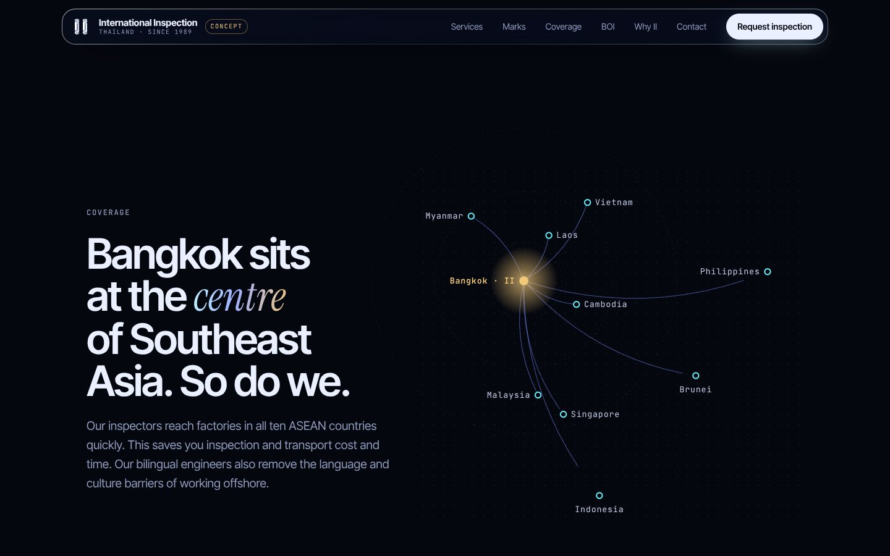
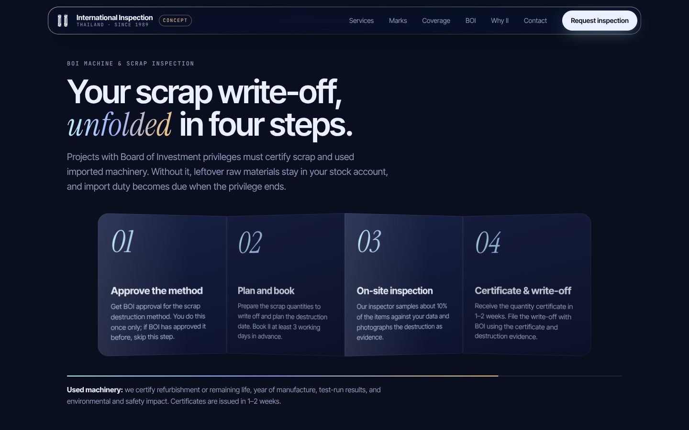
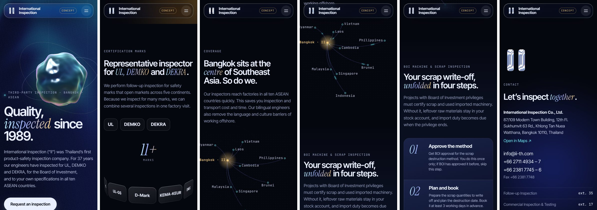

# International Inspection (II) — website concept

A concept redesign of [ii-th.com](https://www.ii-th.com/) for International Inspection Co., Ltd.
All content comes from the crawl in `../reference/ii-th`.

> This is a proposal. It is not the official website. A "Design concept" tag shows in the top bar, and the footer says so too.

## Screenshots

| | |
| --- | --- |
|  |  |
|  |  |
|  |  |

## Run it

```bash
cd site
npm install
npm run dev        # local dev server
npm run build      # type-check and build to site/dist
npm run preview    # serve the build
```

The build is static (`base: './'`). You can host `dist/` on any static host, for example Vercel, Netlify, GitHub Pages or Cloudflare Pages.

## Stack

- Vite, React 19, TypeScript
- three.js and `@react-three/fiber` for the hero scene. This chunk loads after first paint.
- Self-hosted fonts (`@fontsource`): Archivo (variable width, set semi-expanded for headings) and IBM Plex Sans (body). IBM Plex Sans Thai is the matching face for a later Thai version.

## Visual language

The design avoids the usual "AI template" look (gradient text, serif italic accent words, mono uppercase labels, pill buttons, blurred colour blobs). Instead:

- **Palette:** paper `#f5f3ee`, ink `#12131a`, signal blue `#2340f5`, safety yellow `#ffd60a`, stamp orange `#ff5a1f`. No gradient text.
- **Grid:** Swiss-style. Each section has a numbered label in a left column and a full-width rule above.
- **Devices from inspection work:** a yellow highlighter stroke on the hero tagline, rubber-stamp badges for the certification marks, a blueprint grid behind the services, and report-style stat rows.
- **Copy:** plain company language, with II's own tagline "Quality is our priority."

## Design references and where they are used

| Reference | Where | How |
| --- | --- | --- |
| Custom shaders | Hero background | GLSL domain-warped simplex noise with an inspection grid and film grain (`src/effects/HeroScene.tsx`, `Field`) |
| ShaderGradient | Hero background | The same soft, liquid gradient look. It is written as a custom shader, with no extra dependency. |
| Thinking orb | Hero | A noise-displaced, candy-glass sphere with a scan ring. It rests in signal blue. Point at a service chip and the orb "thinks": it pulses, speeds up and changes to that service's colour (`Orb`, `src/state.ts`). |
| react-three-fiber | Hero | Renders the field and the orb. It pauses when the hero is off-screen. |
| liquid-logo (paper-design) | Nav and contact | Raw WebGL liquid-metal "II" mark in the brand colours. A canvas mask becomes a height field, and the shader reflects a flowing environment (`src/effects/LiquidLogo.tsx`). |
| liquidglass.js | Nav, chips, service cards, drawer, form | Per-element edge-displacement map through an SVG `feDisplacementMap` in `backdrop-filter` (`src/effects/Glass.tsx`). The service cards refract the blueprint lines, and the form refracts the shapes behind it. Chromium desktop gets refraction. Other browsers get frosted glass. |
| Screen-fold illusion | BOI section | A nested accordion of panels that folds like paper and unfolds as you scroll (`src/effects/FoldChain.tsx`). |

## Accessibility and performance

- `prefers-reduced-motion`: the WebGL scenes render one still frame, the fold stays flat, and CSS animations stop.
- No WebGL: the hero shows a CSS gradient.
- The service drawer is a modal dialog. It closes with Esc and moves focus to its close button.
- No horizontal scroll at 390 px or 1440 px wide (checked with Playwright).

## Content sources

| Section | Source page in the crawl |
| --- | --- |
| Hero, stats, why us | `/`, `/why-us` |
| Story and timeline | `/about-ii`, Thai BOI page, ISO/IEC 17020 PDFs |
| Services | `/services`, `/follow-up-inspection-services`, `/commercial-inspection-and-testing`, `/testing-services`, `/machine-and-scrap-inspection`, `/sourcing-services` |
| Marks | `/follow-up-inspection-services` |
| BOI four steps | Thai page การตรวจสอบส่วนสูญเสียและเครื่องจักรเก่า, and the BOI scrap conditions PDF (3 working days notice) |
| What we inspect | `/our-expertise` |
| Clients | `/machine-and-scrap-inspection`, `/`, Thai BOI page |
| Documents | The 9 public PDFs. Links go to the original files on ii-th.com. |
| Contact | `/contact` |

## Content audit — please confirm with II

The live site could not be reached from the build environment, so the crawl is the only source. These items need a check:

1. **Office floor.** The contact page says 12th floor. The 2025 ISO/IEC 17020 scope PDF (No. 005/2568) says floor 13. The concept uses the 12th floor from the contact page.
2. **Years of experience.** The old site says "25 years", "30+ years" and "almost 40 years" on different pages. The concept calculates the number from 1989 (37 years in 2026).
3. **Testing services page.** Its "What we provide" and "Benefits" blocks are a copy of the sourcing page. The concept uses only the testing introduction, plus benefits taken from other pages.
4. **ISO/IEC 17020 status.** The PDFs say II *plans to implement* an ISO/IEC 17020 system as a Type A body. The concept does not claim accreditation. Add the accreditation number if II has one.
5. **Copyright year.** The old footer says © 2006. The concept uses the current year.
6. **Spelling.** The concept fixes typos from the old site, for example "Furakawa" → Furukawa, "KEMA-KUER" → KEMA-KEUR, "thier", "refigeration", "baterries".
7. **News.** The only news item is a 2014 UL press release. The concept leaves it out.

## Not in this concept (next steps)

- Thai and Chinese versions. The old site has both. Thai copy for the BOI pages already exists in the crawl.
- The real II logo. The liquid-metal "II" is a placeholder mark.
- Client and certification-mark logos. Use them only with permission. The concept shows names as text.
- Photos of inspectors and factories. Wix image hosting was blocked from the build environment.
- A backend for the form. The form now opens the visitor's email app with a prepared message to info@ii-th.com.
